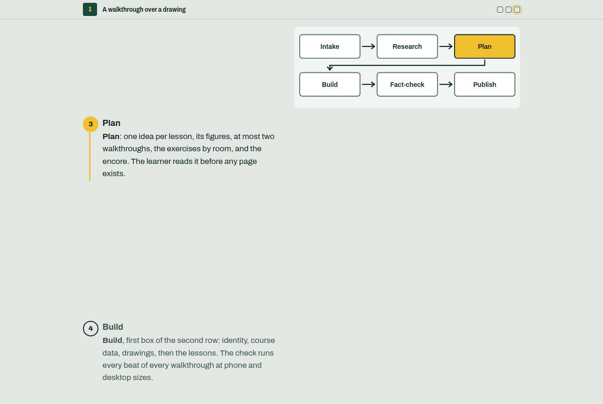

# shared-skills

Claude Code skills I use every day and share with friends and colleagues. The repo is a
[Claude Code plugin marketplace](https://docs.claude.com/en/docs/claude-code/plugin-marketplaces):
add it once, then install whichever skills you want.

```text
/plugin marketplace add elgui/shared-skills
/plugin install lightboard@shared-skills
/plugin install studio-interview@shared-skills
```

Updates: `/plugin marketplace update shared-skills`.

| Skill | What it does |
|---|---|
| [**lightboard**](plugins/lightboard/skills/lightboard/SKILL.md) | Builds a hands-on HTML course for one learner on their own gear, tool or craft |
| [**studio-interview**](plugins/studio-interview/skills/studio-interview/SKILL.md) | Starts an interview on a tele-claude Conversation Studio from your repo, and brings the results back outside git |

---

## lightboard

Tell Claude what you, or someone you know, want to learn, and on what: *"make me a course on my new
camera for my dad, who shot film for thirty years"*, *"teach me the sampler I just bought"*,
*"a course on our deploy pipeline for the new hire"*. Lightboard turns that into a small static
website that teaches **that person** on **their own setup**:

- a **landing board** whose lesson tiles light up as the exercises get done;
- lessons with **one loud idea** each, not a feature list. The learner is assumed to be an expert
  in something next door, so nothing is lectured;
- **walkthroughs**: a figure stays pinned while you scroll numbered steps, and changes at each one;
- **exercises** in the learner's own two practice rooms (say *Lab* to prepare and *Stage* to play),
  each ending on something you can see or hear, and a short game to close every lesson;
- **every claim sourced**. Anything not confirmed carries a visible flag, and the checker fails if
  a flag vanishes without a source.



The pages work offline, fit a 380 px phone, respect reduced motion and stay readable without
JavaScript. A bundled checker proves all of that in a real browser and writes a screenshot of every
step.

It works in stages, and you stay in the loop: **Intake** (who is learning, on what, and what they
call their two rooms) → **Research** (sourced notes) → **Plan** (you review it) → **Build** →
**FactCheck** (independent readers against the notes) → **Publish** (optional, to your own host).

A complete two-lesson example course, about the blocks themselves, is in
[`examples/patterns/`](plugins/lightboard/skills/lightboard/examples/patterns/site/index.html).

### Requirements

- [Bun](https://bun.sh), for the scaffold-and-check tool.
- A Chromium for the checks: `bunx playwright install chromium`, or set `CS_CHROME` to one.
- On first use, Claude runs `bun install` in the skill's `tools/` folder (one dependency,
  `playwright-core`).

### Publishing a course (optional)

A course is plain static files. Each new course gets a `deploy.sh` that `rsync`s the site to a
target you set (`DEST`, `URL`), then checks that an unauthenticated request is **refused**,
because a course carries someone's personal setup and notes. To stop filling it in per course,
put your own template at `~/.config/lightboard/deploy.sh`; every new course will copy it instead.

### Installing without the plugin system

Copy or symlink `plugins/lightboard/skills/lightboard` to `~/.claude/skills/lightboard`.

---

## License

[MIT](LICENSE). Use it, change it, pass it on.
